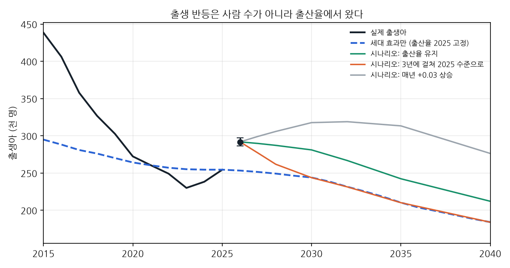
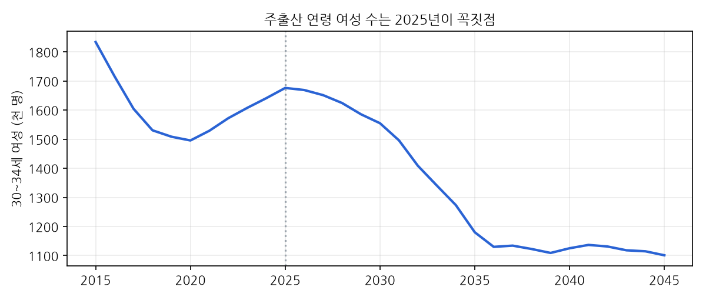

# 출생 반등: 언제 꺾이나 (2026-10-13 기록)

## 한 줄
2026년 출생 반등(+14.7%)은 **사람 수가 아니라 출산율**에서 왔습니다. 주출산 연령 여성 수는 2025년이 꼭짓점이고, 출산율이 지금 수준에 머물면 출생아는 2030년 281,081명, 2035년 242,314명으로 줄어듭니다. 2026년 수준을 지키려면 합계출산율이 2030년 0.96, 2035년 1.11까지 올라야 합니다.

## 사전등록 (발표 전에 장부에 기록)
| 항목 | 예측 | 80% 범위 | 채점 |
|---|---|---|---|
| 2026년 출생아 | **291,838** | 286,281~297,503 | 2027년 2월 연간 잠정 발표 |
| 2027년 출생아 | **290,675** (-0.4%) | 270,556~312,289 | 2028년 2월 |
| 시군구 264곳 2026년 출생아 | data_births/sigungu_2026.csv | 같은 규칙의 과거 적중률 83% | 2027년 8월 확정 발표 |

장부에 0줄 추가. 2027년 예측은 혼인 증가율(1년 전)로 출생 증가율을 설명하는 회귀(1995~2025, 상관 0.45)라 범위가 넓습니다.

## 왜 이렇게 보나
1. **세대 효과**: 1970년 이후 연도별 출생아 수로 각 나이 여성 수를 재구성했습니다(사망·이동 보정계수 0.998, 2015~2025 출생아를 거의 그대로 재현). 출산율을 2025년에 고정하면 출생아는 2026년 −0.5%, 2030년 −4%, 2035년 −17%, 2040년 −28%. 1990년대 초반생(한 해 70만 명대)이 30대 초반을 지나고 나면 2000년대 초반생(2002년 49.7만 명)이 그 자리를 채우기 때문입니다.
2. **행동 효과**: 2026년 출생아 증가는 거의 전부 출산율 상승입니다(추정 합계출산율 0.799 → 0.921). '90년대생이 주출산 연령에 들어섰다'는 설명은 절반만 맞습니다. 그 세대는 이미 꼭짓점이고, 더 밀어 주지 않습니다.
3. **선행 지표**: 2026년 1~7월 혼인은 +6.1%로 2024년(+14.8%)보다 증가 폭이 줄었습니다. 1년 뒤 출생 증가 폭도 줄어드는 신호입니다.

## 시나리오 (출생아, 명)
| 연도 | 세대 효과 | 출산율 유지 | 3년에 걸쳐 2025 수준으로 | 매년 +0.03 상승 | 2026 수준 유지에 필요한 출산율 |
|---|---|---|---|---|---|
| 2026 | 0.995 | 291,838 | 291,838 | 291,838 | 0.921 |
| 2027 | 0.988 | 289,738 | 276,931 | 299,174 | 0.928 |
| 2028 | 0.979 | 287,153 | 261,769 | 305,857 | 0.936 |
| 2030 | 0.959 | 281,081 | 243,809 | 317,698 | 0.956 |
| 2032 | 0.910 | 266,805 | 231,426 | 318,941 | 1.008 |
| 2035 | 0.826 | 242,314 | 210,182 | 313,339 | 1.109 |
| 2040 | 0.723 | 212,103 | 183,978 | 276,312 | 1.267 |

## 누구에게 돈이 되는 정보인가
- 산후조리원·소아과·어린이집·유아용품: 2026~2027년은 높은 평지, 2028년부터 사람 수가 줄어듭니다. 지금 수요를 보고 2030년 용량을 늘리면 과잉이 될 수 있습니다.
- 지자체: 출생 증가가 정책 효과인지 세대·전국 흐름인지 가를 수 있습니다(시군구 증가율 − 시도 증가율).
- 웨딩·혼수(E3): 혼인 증가 폭 축소가 1년 먼저 보입니다.

## 시군구 2026년 출생아 상위 10곳 (일반구 제외 229곳 합계 291,849명 = 전국 추정과 일치)
| 시군구 | 2025 | 2026 예측 | 80% 범위 |
|---|---|---|---|
| 화성시 (31240) | 8,012 | **9,265** | 8,553~10,037 |
| 수원시 (31010) | 6,970 | **8,060** | 7,438~8,735 |
| 용인시 (31190) | 5,764 | **6,666** | 6,146~7,229 |
| 고양시 (31100) | 5,390 | **6,233** | 5,746~6,762 |
| 청주시 (33040) | 5,467 | **6,224** | 5,738~6,752 |
| 성남시 (31020) | 4,953 | **5,728** | 5,278~6,216 |
| 창원시 (38110) | 4,642 | **5,260** | 4,845~5,710 |
| 서구 (23080) | 4,478 | **5,163** | 4,755~5,606 |
| 평택시 (31070) | 4,253 | **4,918** | 4,529~5,342 |
| 안양시 (31040) | 3,780 | **4,371** | 4,022~4,751 |

## 한계
- 시군구는 시도 증가율을 그대로 씁니다. 시군구별 2026년 월별 자료가 나오면 바꿉니다.
- 세대 재구성은 국제 이동을 무시하고 보정계수 하나로 맞췄습니다. 10년 이상 앞은 방향만 보세요.
- 2026년 남은 5개월 변동 ±1.5%는 판단값입니다. 2027년 2월 채점으로 확인합니다.
- 추정 합계출산율 0.92는 '1~7월 출생 증가율 ÷ 세대 효과'로 낸 연간 환산값입니다. 공표된 7월 합계출산율 0.89와 차이가 있어 0.89~0.92로 읽으세요.
