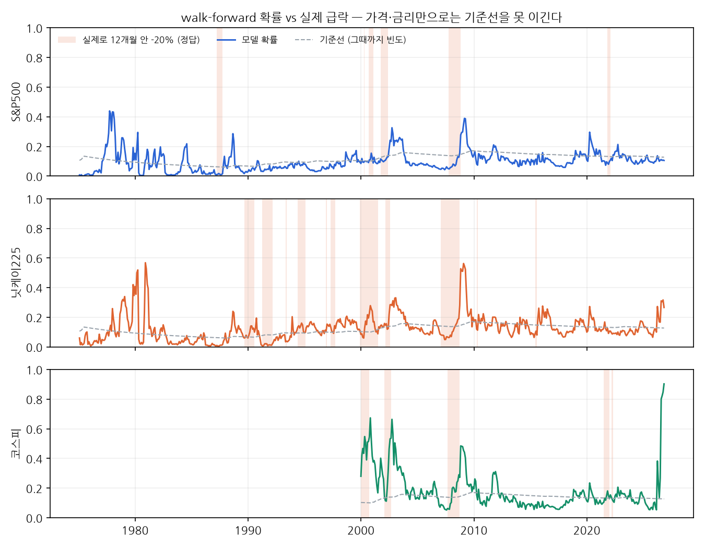
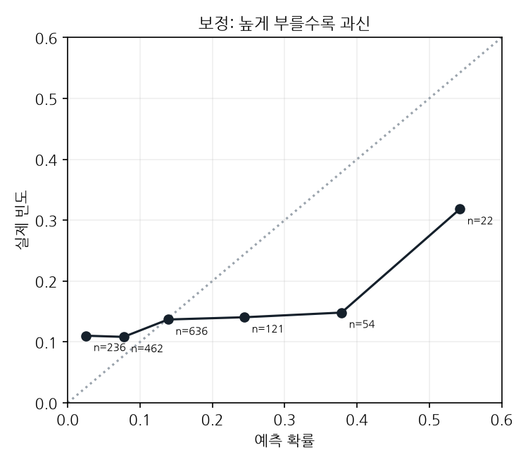

# 과열 온도계 v0 — 12개월 안에 20% 넘게 빠질 확률

기준 2026-10 (10월은 13일까지 종가). 장부 기록 6줄 (kind=crisis_risk, v0 3 + v1 도전자 3, 해시 체인). 투자 권유가 아니라 채점받을 예측입니다.

## 한 줄 결론
**가격·금리만으로 만든 v0는 '그냥 평소 빈도'보다 못 맞힌다** (Brier 0.1163 vs 기준선 0.1136, skill -0.023, n=1531).
킨들버거 표가 말하는 핵심 연료는 **신용(새 은행·대출·자본 유입)** 인데 v0엔 그게 없다. 신용 자료를 붙이는 v1이 진짜 시험.

## 이번 달 확률 (사전등록)
| 시장 | 확률 (80% 범위) | 기준선 | 기준가 → −20% 선 | 3년 수익률 | 12개월 변동성 | 학습 범위 밖 |
|---|---|---|---|---|---|---|
| S&P500 | 11% (8%–13%) | 13% | 7,807 → 6,246 | +62% | 13% | — |
| 닛케이225 | 27% (20%–33%) | 13% | 67,778 → 54,222 | +79% | 29% | — |
| 코스피 | 90% (80%–95%) | 13% | 6,035 → 4,828 | +97% | 60% | ret36, vol12 |

- 채점: 2026-11 ~ 2027-10 월말 종가 중 최저가가 −20% 선 이하이면 1, 아니면 0. 2027-11에 Brier로 채점.
- **코스피 수치는 외삽.** 12개월 변동성·3년 수익률이 1960년 이후 세 시장 어디에도 없던 값이라, 모델이 본 적 없는 영역이다.
  80% 범위는 계수 흔들림만 반영하고 이 외삽 위험은 반영하지 못한다. 이미 고점 대비 크게 빠진 뒤라는 점도 모델은 모른다(현재 낙폭 특성 없음).
- 계수(표준화): const -2.05, ret36 +0.32, accel +0.20, gap10 -0.53, vol12 +0.43, rate6 -0.20, turn +0.04

## 백테스트 (walk-forward, 1975~, 매달 그때 알 수 있던 자료로만 다시 학습)
| 시장 | n | 실제 급락 빈도 | skill |
|---|---|---|---|
| S&P500 | 610 | 7.5% | -0.060 |
| 닛케이225 | 610 | 16.6% | -0.061 |
| 코스피 | 311 | 15.4% | +0.095 |

보정표 — 높게 부를수록 과신한다:

| 예측 구간 | n | 평균 예측 | 실제 |
|---|---|---|---|
| (0.0, 0.05] | 236 | 2.5% | 11.0% |
| (0.05, 0.1] | 462 | 7.7% | 10.8% |
| (0.1, 0.2] | 636 | 13.9% | 13.7% |
| (0.2, 0.3] | 121 | 24.4% | 14.0% |
| (0.3, 0.5] | 54 | 37.9% | 14.8% |
| (0.5, 1.0] | 22 | 54.2% | 31.8% |

### 정직하게: 시험한 변형
설계(특성 6개)를 정한 뒤 결과를 보고 단일 특성·작은 조합 9개를 더 돌려봤다. 가장 좋은 것(10개월선 이격 + 변동성)이 skill +0.016.
9개 중 최고라 운일 가능성이 커서 채택하지 않았다. 사전등록은 처음 설계 그대로.

## 킨들버거 부록 46건 — 투기 대상·연료 태그
| 태그 | 건수 | 비율 |
|---|---|---|
| new_banks | 22 | 48% |
| new_tech | 21 | 46% |
| commodity | 19 | 41% |
| real_estate | 16 | 35% |
| capital_inflow | 10 | 22% |
| war_end | 9 | 20% |
| credit_innovation | 8 | 17% |
| foreign_debt | 5 | 11% |
| war | 4 | 9% |
| rate_cut | 3 | 7% |
| deregulation | 2 | 4% |
| currency | 2 | 4% |
| foreign_trade | 2 | 4% |
| leverage | 2 | 4% |

new_banks(새 은행·신용)와 new_tech(신기술)가 절반 가까이. rate_cut은 3건뿐이라 금리만 보는 v0가 약한 것과 맞아떨어진다.

## v1: KOSIS 신용 자료를 붙인 결과 (규칙은 결과 보기 전에 정함)
- 추가 특성: cg3 = 민간신용/GDP 3년 변화(%p, KOSIS DT_2AQ551, Y년 값은 Y+1년 6월부터 사용), dd12 = 12개월 고점 대비 낙폭
- 같은 1531개월에서: v0 skill -0.045 vs v1 skill -0.093 → **v1 탈락 → v0 유지.** 신용을 붙여도 기준선을 못 이겼다
- 시장별로는 갈린다: 미국·일본은 v1이 나아졌고(기준선엔 여전히 못 미침) 코스피에서 크게 나빠져 전체가 떨어졌다. 한국 표본은 2000년 이후 26년뿐
- 계수 방향은 이론대로(cg3 양수: 신용이 빨리 늘수록 위험). 그런데 밖에서 맞혀 보면 과신이 더 심해졌다 — 50% 넘게 부른 달 실제 빈도가 낮다

| 시장 | v0 skill | v1 skill |
|---|---|---|
| S&P500 | -0.145 | -0.102 |
| 닛케이225 | -0.069 | -0.016 |
| 코스피 | +0.112 | -0.248 |

| 예측 구간 | n | 평균 예측 | 실제 |
|---|---|---|---|
| (0.0, 0.05] | 371 | 2.2% | 9.4% |
| (0.05, 0.1] | 414 | 7.6% | 8.9% |
| (0.1, 0.2] | 432 | 13.9% | 12.3% |
| (0.2, 0.3] | 107 | 24.3% | 26.2% |
| (0.3, 0.5] | 144 | 38.4% | 19.4% |
| (0.5, 1.0] | 63 | 70.4% | 22.2% |

### 도전자로 함께 등록 (v1, 채점은 v0와 같은 날)
| 시장 | v1 확률 (80% 범위) | 신용/GDP 3년 변화 | 12개월 고점 대비 | 학습 범위 밖 |
|---|---|---|---|---|
| S&P500 | 10% (8%–12%) | +14.2%p | +0% | — |
| 닛케이225 | 14% (10%–19%) | +0.6%p | -3% | — |
| 코스피 | 70% (47%–85%) | -2.4%p | -29% | ret36, vol12 |

계수(표준화): const -2.13, ret36 +0.32, accel +0.34, gap10 -0.18, vol12 +0.16, rate6 -0.25, turn +0.01, cg3 +0.48, dd12 -0.51

### 한국 가계신용 (KOSIS DT_151Y001, 참고 지표 — 한국만 있어 학습엔 안 씀)
| 분기 | 잔액(조원) | 전년비 |
|---|---|---|
| 2025Q1 | 1,925 | +2.4% |
| 2025Q2 | 1,950 | +3.0% |
| 2025Q3 | 1,965 | +2.8% |
| 2025Q4 | 1,979 | +3.0% |
| 2026Q1 | 1,994 | +3.6% |
| 2026Q2 | 2,020 | +3.6% |

**해석 (판단):** 코스피의 높은 확률은 가격(3년 +97%, 변동성)에서 나온다. 신용 쪽은 과열 신호가 약하다 — 민간신용/GDP는 3년 사이 줄었고
가계신용 증가율도 3%대. 킨들버거 기준으로는 '신용 연료 없는 가격 급등'에 가까워, 금융 위기보다는 가격 조정 쪽 그림이다.

## 다음 단계
- 과신 보정: 모델 확률을 기준선 쪽으로 줄이는 축소 — v0·v1 모두 높게 부를 때 틀린다.
- 연간 신용/GDP는 너무 거칠다(발표 시차 6~18개월). 분기 신용 갭(BIS)은 도메인이 막혀 있음.
- 표본: 세 시장 50년에 급락 구간이 몇십 개뿐. 나라를 늘리려면 지수 자료(유럽·대만 등)가 더 필요.
