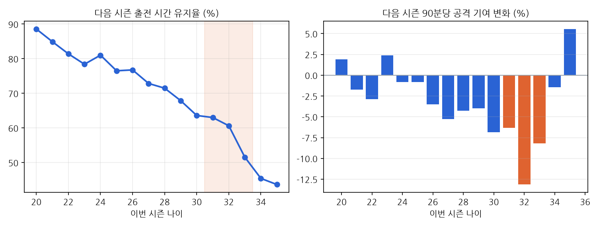

# 베테랑 노화 곡선 (원칙 3 시험)

자료: fbref 5대 리그 선수 시즌 기록 2009/10~2025/26, 같은 선수 연속 두 시즌 비교. 이번 시즌 900분 이상, 골키퍼 제외.
90분당 공격 기여 = npxG + xAG (2017/18~, 공격수·미드필더, 다음 시즌 450분 이상). 가설은 결과 보기 전 장부 등록. 판정: 95% 범위 전체가 가설 쪽이면 맞음, 전체가 반대면 틀림, 걸치면 불확실.

## 가설 판정
| 가설 | 결과 | 판정 |
|---|---|---|
| H1 31~33세 90분당 기여 하락 10% 미만 (자신감 60%) | -8.9% (95% -12.8% ~ -5.0%), n=310 | 불확실 (점추정은 가설 쪽) |
| H2 출전 유지율이 25~29세보다 20%p 이상 낮음 (자신감 70%) | 유지율 차이 +13.9%p (95% +11.5% ~ +16.2%), 31~33세 60% vs 25~29세 73% | 틀림 |
| H3 31~32세 하락이 25~29세와 5%p 이내 (자신감 50%) | 하락 차이 +5.6%p (95% +0.7% ~ +10.2%) | 불확실 (점추정은 반대쪽) |

- 다음 시즌 5대 리그에서 사라진 비율: 31~33세 26%, 25~29세 17% (은퇴·하부 리그·해외 이적 포함, 실력 하락만은 아님)

## 나이별
| 나이 | 선수-시즌 | 다음 시즌 출전 유지율 | 90분당 표본 | 90분당 기여 변화 |
|---|---|---|---|---|
| 20 | 826 | 89% | 193 | +1.9% |
| 21 | 1207 | 85% | 273 | -1.7% |
| 22 | 1562 | 81% | 329 | -2.9% |
| 23 | 1747 | 78% | 357 | +2.4% |
| 24 | 1922 | 81% | 391 | -0.8% |
| 25 | 1972 | 77% | 367 | -0.8% |
| 26 | 1900 | 77% | 355 | -3.5% |
| 27 | 1809 | 73% | 332 | -5.3% |
| 28 | 1658 | 71% | 290 | -4.3% |
| 29 | 1490 | 68% | 244 | -4.0% |
| 30 | 1261 | 64% | 201 | -6.8% |
| 31 | 965 | 63% | 147 | -6.3% |
| 32 | 705 | 61% | 95 | -13.1% |
| 33 | 516 | 52% | 68 | -8.2% |
| 34 | 327 | 45% | 42 | -1.4% |
| 35 | 181 | 44% | 25 | +5.6% |

## 한계
- 다음 시즌에도 뛴 선수만 90분당 변화를 잴 수 있음 → 크게 떨어진 선수는 빠졌을 수 있어 하락이 덜 보일 수 있음 (생존자 편향)
- 출전 유지율 0에는 하부 리그·사우디·MLS 이적이 섞여 있음 (실력 하락만은 아님)
- 수비수의 기여는 이 지표로 못 잼. 가격(이적료·연봉) 자료 없음 → '가격 대비' 결론은 아직 못 냄
