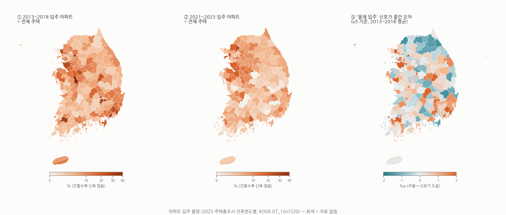

# 아파트 입주 물량 지도

- ① 2013~2018 신축 비율 상위(%): 세종특별자치시 세종시 49.4, 부산광역시 강서구 43.7, 경기도 하남시 41.0, 대구광역시 달성군 35.0, 전라남도 나주시 32.0, 부산광역시 기장군 26.6, 충청북도 청원구 26.0, 경기도 김포시 26.0
- ② 2021~2025 신축 비율 상위(%): 대구광역시 중구 38.7, 경기도 과천시 38.7, 경기도 양주시 28.4, 인천광역시 서구 24.5, 인천광역시 중구 23.8, 경기도 팔달구 20.8, 전라남도 광양시 19.9, 대구광역시 서구 19.7
- ③ '올해 입주' 신호가 오차를 가장 많이 줄인 곳(%p): 부산광역시 강서구 9.8, 경기도 하남시 9.8, 대구광역시 달성군 8.3, 전라남도 나주시 6.3, 경기도 화성시 5.7, 경기도 김포시 4.4. 오차를 줄인 시군구 비율 60%
