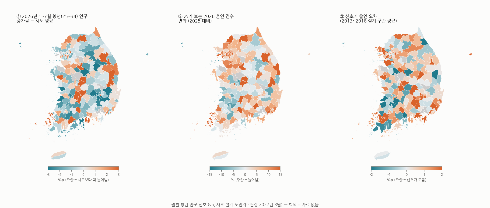

# 청년 인구 신호 지도 (v5)

- ① 청년이 시도보다 많이 늘어난 곳: 경상북도 청송군 +15.5, 전북특별자치도 무주군 +9.6, 대구광역시 남구 +7.9, 전북특별자치도 장수군 +7.9, 충청북도 보은군 +7.6, 충청북도 옥천군 +7.5
- ① 청년이 시도보다 많이 줄어든 곳: 충청북도 괴산군 -8.7, 경상북도 청도군 -6.0, 경상북도 성주군 -5.5, 충청남도 서천군 -3.9, 충청북도 단양군 -3.6, 전라남도 여수시 -3.5
- ② v5가 2026 혼인 증가를 가장 크게 보는 곳: 경상북도 청송군 +30.4, 전라남도 구례군 +27.7, 강원특별자치도 정선군 +27.0, 경기도 광명시 +25.8, 충청북도 보은군 +25.8, 전북특별자치도 장수군 +25.5
- ③ 설계 구간에서 신호가 오차를 줄인 시군구 비율: 69%. 가장 많이 줄인 곳: 부산광역시 강서구 +15.0, 경기도 하남시 +8.0, 대구광역시 달성군 +7.9, 경기도 화성시 +7.4, 전라남도 나주시 +6.1
- 시도별 v5 2026 혼인 변화 중앙값(%): 서울특별시 +12.7, 인천광역시 +10.8, 부산광역시 +8.3, 경상남도 +6.6, 경기도 +5.9, 대구광역시 +4.6, 충청남도 +3.5, 강원특별자치도 +3.2, 전라남도 +3.0, 울산광역시 +2.8, 경상북도 +1.6, 제주특별자치도 +1.1, 충청북도 +0.4, 광주광역시 -0.2, 전북특별자치도 -3.4, 대전광역시 -6.9
